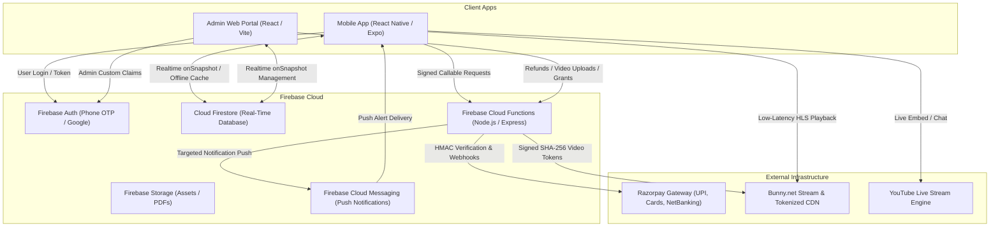

# 🏛 System Architecture & Technical Specifications

This document outlines the full end-to-end architecture, data flows, Firestore collection schemas, and Cloud Functions catalog for the **YouTube Sikho Course App Platform**.

---

## 1. High-Level Architecture Diagram

---

## 2. Core Operational Data Flows

### A. Course Purchase & Instant Enrollment
1. **Initiate**: Student taps "Enroll Now" in [`app/checkout/[courseId].tsx`](app/checkout/[courseId].tsx).
2. **Order Creation**: Client calls `createOrder` Cloud Function with `courseId` and optional `couponCode`.
3. **Price Calculation**: Cloud Function calculates final discounted amount on the server (preventing client-side tampering) and requests an official `order_id` from Razorpay API.
4. **Checkout Modal**: Mobile app opens native Razorpay checkout sheet with UPI / Google Pay / Cards.
5. **Signature Verification**: On payment success, client sends payment ID and signature to `verifyPayment` Cloud Function.
6. **Enrollment Unlock**: Cloud Function verifies SHA-256 HMAC cryptographic signature against `RAZORPAY_KEY_SECRET`. Upon confirmation, it writes an active record to `/enrollments/{uid}_{courseId}` and records receipt in `/orders/{orderId}`.
7. **Real-time Activation**: Mobile app's `onSnapshot` listener on `/enrollments` triggers instantly, unlocking all course lessons without requiring an app refresh.

---

### B. Secure Tokenized Video Playback
1. **Lesson Access Check**: Student taps a video lesson in [`app/player/[lessonId].tsx`](app/player/[lessonId].tsx).
2. **Access Verification**: Client invokes `getVideoToken` Cloud Function providing `courseId` and `lessonId`.
3. **Authorization**: Server confirms caller has an active enrollment in `/enrollments/{uid}_{courseId}`.
4. **Token Generation**: Cloud Function generates a time-limited SHA-256 signed Bunny Stream token (valid for 4 hours), locking the stream to the student's IP address.
5. **Secure Stream**: Player initializes low-latency HLS stream (`.m3u8`). Video cannot be downloaded, shared, or played outside the authorized session.

---

### C. Live Interactive Classes & Doubt Clearing
1. **Class Scheduling**: Admin creates or starts a live class in [`admin/src/pages/LiveClasses.tsx`](admin/src/pages/LiveClasses.tsx).
2. **Real-Time Notification**: Cloud Function dispatches FCM push notification to all students enrolled in the course.
3. **Live Sync**: Mobile [`app/(tabs)/live.tsx`](app/(tabs)/live.tsx) displays flashing red `LIVE NOW` badge.
4. **Interactive Room**: Students enter the live room, watch the live broadcast, participate in rate-limited real-time chat, and raise hands for doubt clearing.
5. **Replay Archiving**: When admin ends the stream, the class status updates to `ended` and the replay recording is immediately made available for students.

---

## 3. Firestore Collection Schema Catalog

| Collection Path | Document Key Format | Primary Fields & Types | Purpose | Access Control |
| :--- | :--- | :--- | :--- | :--- |
| `/appConfig/main` | `main` | `appName` (string), `colors` (map), `maintenanceMode` (boolean), `minAppVersion` (string), `supportWhatsApp` (string) | Remote theming, emergency maintenance switch, and global contacts | Public Read, Admin Write |
| `/categories` | `category_{id}` | `name` (string), `order` (number), `icon` (string), `slug` (string) | Course taxonomy filter chips | Public Read, Admin Write |
| `/courses` | `course_{id}` | `title` (string), `price` (number), `discountPrice` (number), `thumbnailUrl` (string), `isPublished` (boolean), `sections` (array) | Course master data and syllabus curriculum | Public Read (Published), Admin Write |
| `/banners` | `banner_{id}` | `title` (string), `imageUrl` (string), `targetType` (string), `targetValue` (string), `order` (number), `isVisible` (boolean) | Home promotional carousel slides | Public Read, Admin Write |
| `/homeSections` | `sec_{type}` | `type` (string), `title` (string), `order` (number), `isVisible` (boolean) | Dynamic reordering and visibility of home screen modules | Public Read, Admin Write |
| `/users` | `{uid}` | `name` (string), `phone` (string), `email` (string), `isBlocked` (boolean), `fcmToken` (string), `createdAt` (timestamp) | Student user profiles and device push tokens | Owner Read/Write, Admin Read/Write |
| `/enrollments` | `{uid}_{courseId}` | `uid` (string), `courseId` (string), `status` (active / revoked), `enrolledAt` (timestamp) | Access entitlement record | Owner Read, Functions/Admin Write |
| `/orders` | `{orderId}` | `uid` (string), `courseId` (string), `amount` (number), `status` (paid / refunded), `razorpayPaymentId` (string) | Payment receipts and transaction auditing | Owner Read, Functions/Admin Write |
| `/coupons` | `{code}` | `code` (string), `discountType` (percentage/fixed), `value` (number), `isActive` (boolean), `maxUses` (number) | Checkout discount validation | Authenticated Read, Admin Write |
| `/liveClasses` | `class_{id}` | `title` (string), `courseId` (string), `scheduledAt` (string), `streamUrl` (string), `status` (scheduled/live/ended), `chatEnabled` (boolean) | Live broadcast schedules and status tracking | Authenticated Read, Admin Write |
| `/liveClasses/{id}/messages` | `msg_{id}` | `senderId` (string), `senderName` (string), `message` (string), `createdAt` (timestamp) | Real-time live room student chat stream | Enrolled Read/Write, Admin Moderate |
| `/quizzes` | `quiz_{id}` | `title` (string), `courseId` (string), `passingPercentage` (number), `timeLimitMinutes` (number), `questionCount` (number) | Quiz metadata for students | Authenticated Read, Admin Write |
| `/quizzes/{id}/questions` | `q_{id}` | `question` (string), `options` (array), `correctAnswerIndex` (number), `explanation` (string) | True answers and scoring key | Cloud Functions & Admin ONLY (Student Read DENIED) |
| `/quizResults` | `res_{id}` | `uid` (string), `quizId` (string), `score` (number), `percentage` (number), `passed` (boolean), `submittedAt` (timestamp) | Verified test evaluation results | Owner Read, Cloud Functions Write |
| `/certificates` | `cert_{id}` | `uid` (string), `studentName` (string), `courseId` (string), `courseTitle` (string), `issueDate` (string), `verificationHash` (string) | Course completion certificates with QR code verification | Public Read, Cloud Functions Write |
| `/tickets` | `ticket_{id}` | `uid` (string), `studentName` (string), `subject` (string), `status` (open/in_progress/resolved), `messages` (array) | In-app customer support desk | Owner Read/Write, Admin Read/Write |

---

## 4. Cloud Functions Catalog

| Function Name | Type & Trigger | Input Parameters | Output Response | Authentication Requirement |
| :--- | :--- | :--- | :--- | :--- |
| `createOrder` | `onCall` (HTTPS) | `{ courseId, couponCode? }` | `{ orderId, razorpayOrderId, amount, currency }` | Authenticated Student (`request.auth.uid`) |
| `verifyPayment` | `onCall` (HTTPS) | `{ orderId, razorpayPaymentId, razorpaySignature }` | `{ success: true, enrollmentId }` | Authenticated Student |
| `razorpayWebhook` | `onRequest` (Webhook) | Razorpay Webhook Payload & `X-Razorpay-Signature` | `{ status: "ok" }` | HMAC Webhook Secret Verification |
| `refundPayment` | `onCall` (HTTPS) | `{ orderId, reason }` | `{ success: true, refundId }` | Admin Role Required (`request.auth.token.admin`) |
| `getVideoToken` | `onCall` (HTTPS) | `{ courseId, lessonId }` | `{ videoUrl, token, expiresIn }` | Enrolled Student or Course Admin |
| `createBunnyUpload` | `onCall` (HTTPS) | `{ title }` | `{ videoId, uploadUrl, libraryId }` | Admin Role Required |
| `submitQuiz` | `onCall` (HTTPS) | `{ quizId, answers, timeTakenSeconds }` | `{ resultId, score, percentage, passed }` | Authenticated Student |
| `sendNotification` | `onCall` (HTTPS) | `{ title, body, target, targetCourseId? }` | `{ success: true, count }` | Admin Role Required |
| `manageEnrollment` | `onCall` (HTTPS) | `{ uid, courseId, action: "grant" \| "revoke" }` | `{ success: true }` | Admin Role Required |
| `deleteAccount` | `onCall` (HTTPS) | `{}` | `{ success: true }` | Authenticated User |
