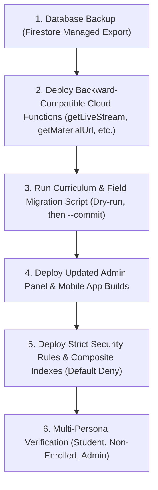

# 🔄 Platform Migration & Architecture Alignment Guide

This guide documents the database schema and media asset migrations required to align existing data with **ARCHITECTURE.md**.

---

## 1. Video Player & Media Assets (Unlisted YouTube Architecture)

### Problem
Previously, lessons stored video IDs or URLs in the publicly readable lesson document (`courses/{courseId}/sections/{sectionId}/lessons/{lessonId}`), which bypassed paid enrollment checks and allowed any user to inspect and play videos directly.

### Migration Action
1. **Recorded Lessons**:
   - Recorded lessons use **Unlisted** YouTube videos pasted as a link in the admin panel and validated with the YouTube Data API v3.
2. **Private Media Document Protection**:
   - The video ID and playback parameters are written to the private subcollection:
     `/courses/{courseId}/sections/{sectionId}/lessons/{lessonId}/private/media`
   - Public lesson documents retain only `title`, `duration`, `isFreePreview`, `order`, `hasMedia`, and `provider: 'youtube'`.
   - The mobile app requests the video ID via the `getLessonPlayback` Cloud Function, which verifies active enrollment before returning the ID.

---

## 2. Quiz Anti-Cheat & Schema Alignment

### Schema Standardization
Fields across Firestore, Admin, Cloud Functions, and Mobile App are aligned to:
- `title` (string)
- `courseId` (string)
- `passingPercentage` (number)
- `timeLimitMinutes` (number)
- `questionCount` (number)
- Subcollection `/questions/{questionId}`:
  - `question` (string)
  - `options` (array of strings)
  - `correctAnswerIndex` (number, 0-indexed)
  - `explanation` (string)
  - `marks` (number)
  - `order` (number)

### Client Fetching
Students never read `/quizzes/{id}/questions` directly. The mobile app invokes the `getQuizQuestions` Cloud Function, which returns question prompts and options without the answer keys.

---

## 3. Server-Authoritative Razorpay & Enrollment Schema Migration

### Orders Schema Standardization
- Direct UPI simulated endpoints (`YouPI`), manual UTR entries, and client-side pricing are **strictly removed**.
- Database amounts are stored in integer paise (`amountPaise: number`), eliminating floating-point currency bugs.
- Order `status` values: `'created' | 'paid' | 'refunded' | 'failed'`.
- Orders can only be created and updated by Cloud Functions (`createOrder`, `verifyPayment`, `razorpayWebhook`, `refundPayment`) via the Firebase Admin SDK. Client-side write access is completely blocked in `firestore.rules`.

### Enrollments Schema Standardization
- Field `active: boolean` is migrated to unified lifecycle state: `status: 'active' | 'revoked' | 'expired'`.
- Key format: `enrollments/{uid}_{courseId}`.
- Student access checks inspect `status === 'active'`.
- All writes are restricted to Cloud Functions (`verifyPayment`, `razorpayWebhook`, `manageEnrollment`); client-side direct writes are denied in `firestore.rules`.

### Coupons Schema Standardization
- Document location: `coupons/{CODE}` (UPPERCASE string document ID).
- Fields:
  - `code` (string, uppercase)
  - `discountType` (`'percent' | 'flat'`)
  - `value` (number: percent 1-100 or flat INR)
  - `isActive` (boolean)
  - `maxUses` (number, 0 = unlimited)
  - `usedCount` (number, incremented inside atomic transaction)
  - `expiresAt` (ISO string or timestamp or null)
  - `minPrice` (optional minimum course price in rupees)
  - `courseIds` (optional array of restricted course IDs)
- Client-side reads from mobile are blocked in `firestore.rules`; coupon validation is performed server-side via the `validateCoupon` callable Cloud Function.

---

## 4. Part 4: Curriculum Subcollection, Schema Canonicalization & Rules Migration

### A. Comprehensive Field Canonicalization Matrix

| Collection | Legacy Code / Admin / Rules | ARCHITECTURE.md | Proposed Canonical Field | Migration Strategy |
| :--- | :--- | :--- | :--- | :--- |
| **`banners`** | `active` (rules & indexes) / `isVisible` (code) | `isVisible` | **`isVisible`** | Update rules & indexes to `isVisible`. Script backfills `isVisible = true` if `active == true`. |
| **`courses`** | `thumbnail` (app) / `thumbnailUrl` (admin) | `thumbnailUrl` | **`thumbnailUrl`** | Keep backward-compatible getter in app; script migrates `thumbnail` -> `thumbnailUrl`. |
| **`courses`** | `category` (app) / `categoryId` (admin) | `categoryId` | **`categoryId`** (with optional `category` string for UI display) | Store foreign key `categoryId` and maintain category display label. |
| **`courses`** | `duration` ("12h 30m") | `totalDurationSeconds` | **`totalDurationSeconds`** & **`totalLessons`** | Compute dynamically from lessons during curriculum migration. |
| **`courses`** | `sections` (embedded array with `videoId` / `pdfUrl`) | Subcollections | **Subcollections** (`sections/{sId}/lessons/{lId}`) | Move to subcollections; private media to `lessons/{lId}/private/media`. Remove array from course doc. |
| **`liveClasses`** | `streamUrl` on public doc | `streamUrl` | **`liveClasses/{id}/private/stream`** | Move stream URL to private subdoc. Free streams or enrolled students access via `getLiveStream` callable. |
| **`liveClasses/messages`** | `uid`, `userName`, `text` (code) | `senderId`, `senderName`, `message` | **`uid`**, **`userName`**, **`text`** | Standardize on `uid`, `userName`, `text` (aligns with `users/{uid}` and existing UI). Update ARCHITECTURE.md. |
| **`quizzes`** | `passMarks`, `durationMinutes`, `questionsCount` | `passingPercentage`, `timeLimitMinutes`, `questionCount` | **`passingPercentage`**, **`timeLimitMinutes`**, **`questionCount`** | Update Admin and functions to canonical names; migrate existing documents. |
| **`quizzes/questions`** | `questionText`, `correctOptionIndex` | `question`, `correctAnswerIndex` | **`question`**, **`correctAnswerIndex`** | Update Admin question builder to canonical names; script backfills legacy keys. |
| **`tickets`** | `status: 'closed'` / `userName` | `status: 'resolved'` / `studentName` | **`status: 'open' \| 'in_progress' \| 'resolved'`** / **`studentName`** | Support `'closed'` as alias in UI; canonical status in DB is `'resolved'`. |
| **`notifications`** | Direct student read of `/notifications` | Inbox isolation | **`/userNotifications/{uid}/items`** | Students read only personal items. `/notifications` locked to Admin broadcast history. |
| **`materials`** | `allow read: if isAuthenticated()` | Enrolled check | **`isEnrolled(courseId)`** | Lock Firestore & Storage rules to verified course enrollment. Short-lived URLs via `getMaterialUrl`. |

---

### B. Deployment & Rollout Sequence

To ensure zero downtime and prevent permission failures, all updates must be rolled out in this strict order:

1. **Step 1: Database Backup**:
   Run full Firestore managed export to Google Cloud Storage bucket before touching documents.
2. **Step 2: Deploy Cloud Functions**:
   Deploy new and updated functions (`getLiveStream`, `getMaterialUrl`, `deleteCourse`, `deleteQuiz`, `deleteLiveClass`, `validateCoupon`).
3. **Step 3: Run Data Migration Script**:
   Execute `node scripts/migrate-curriculum.js` (dry-run first to inspect transformations, then with `--commit`).
4. **Step 4: Deploy Admin & Mobile Client**:
   Publish the updated Admin Panel and submit new Mobile EAS build with subcollection listeners and query filters matching rules.
5. **Step 5: Deploy Security Rules & Indexes**:
   Deploy locked `firestore.rules`, `firestore.indexes.json`, and `storage.rules`. Because the client apps now filter on `where('isPublished', '==', true)` and `where('isVisible', '==', true)`, queries will match rules perfectly.
6. **Step 6: Verification Smoke Tests**:
   Verify access as:
   - Non-enrolled user (cannot access private stream, private media, or paid materials).
   - Enrolled user (can access tokenized video, study materials, and submit reviews).
   - Admin user (can manage content, issue refunds, view audit logs).
