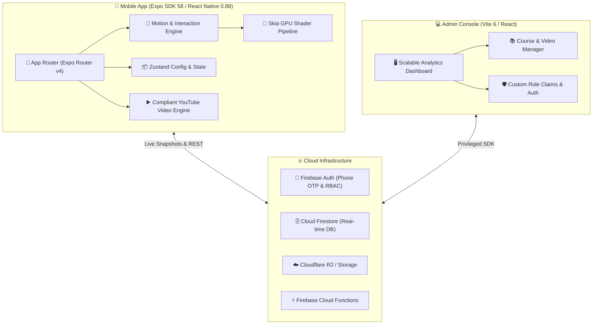

<div align="center">

# 🚀 YouTube Sikho Academy
### *Next-Gen White-Label EdTech & Course Platform*

[](https://expo.dev)
[](https://reactnative.dev)
[](https://www.typescriptlang.org)
[](https://firebase.google.com)
[](https://shopify.github.io/react-native-skia/)
[](https://expo.dev/accounts/vikash0873/projects/youtube-sikho)

<br/>

> **YouTube Sikho** is an ultra-fluid, enterprise-grade white-label learning platform engineered with React Native 0.88 and Expo SDK 58. Featuring physics-based micro-interactions, hardware-accelerated Skia shaders, zero-overhead YouTube compliance, and real-time Firebase architecture.

<br/>

[📱 Download Android APK](#-standalone-android-apk) • [✨ Motion System](#-motion--interaction-system) • [🏗 Architecture](#-system-architecture) • [⚡ Getting Started](#-getting-started) • [🔒 Security](#-security--compliance)

---

</div>

<br/>

## 🌟 Key Highlights & Engineering Features

```
┌─────────────────────────────────────────────────────────────────────────────┐
│                             YOUTUBE SIKHO ACADEMY                           │
├─────────────────────┬───────────────────────────┬───────────────────────────┤
│ 🎨 Motion & 3D UI   │ 🛡 Enterprise Resilience  │ ⚡ Performance            │
│ • Custom Skia Glass │ • Zero-Overlay YouTube    │ • Hermes Bytecode 6.3MB   │
│ • 60-80 Confetti FX │ • Strict App Check Auth   │ • 60 FPS Spring Gestures  │
│ • 10 Vector Lotties │ • Multi-Tenant Client Cfg │ • 3-Tier Device Fallback  │
│ • Tactile Haptic FX │ • Offline SQLite Cache    │ • Instant Asset Pre-load  │
└─────────────────────┴───────────────────────────┴───────────────────────────┘
```

<br/>

### 1. 🎬 Zero-Friction Video & Live Class Experience
- **YouTube Iframe Compliance**: Strictly adheres to YouTube API Terms of Service. Embedded players (`app/live/[id].tsx` and `src/components/video/InAppStreamPlayer.tsx`) operate in isolated view hierarchies with zero touch intercepts, watermarks, or overlays over player viewports.
- **Dynamic Orientation & Fullscreen**: Seamlessly locks into landscape with responsive aspect ratio preservation and automatic background pause handling.

### 2. 💎 3D Shaders & Motion Design System
- **Real-Time Skia Shaders**: GPU-driven fluid gradients (`SoftGradientBackground`), shimmering skeleton loaders (`ShimmerSkeleton`), and multi-layer frosted glass effects (`GlassBlur`).
- **Dynamic Physics Springs**: Standardized bounce and friction curves (`gentle`, `snappy`, `bouncy`, `interactive`) across all user touchpoints.
- **Hardware Tiering & Accessibility**: Automatically inspects device RAM and system battery status. Automatically downgrades heavy rendering to basic opacity transitions when `reduceMotion` is requested or device is `low-tier`.
- **10 Bespoke Vector Lotties**: Lightweight JSON vector animations for Splash, Payment Success, Course Completion, Streak Flames, Empty States, and Offline banners.

### 3. 📚 Gamified Learning & Assessment
- **Interactive Quizzes**: Tinder-style swipeable card interactions (`useQuizCardSwipe`) with instant haptic affirmative/error pulses.
- **Auto-Generated Certificates**: Dynamic canvas-rendered completion certificates (`app/certificate/[courseId].tsx`) ready for 1-tap download and social sharing.
- **Instant Enrollment Sync**: Real-time Firestore transaction hooks ensuring atomic course enrollments with zero duplicate purchases.

---

<br/>

## 📱 Standalone Android APK

The production standalone application is compiled via Expo Application Services (EAS) with remote managed keystores and native optimization.

| Metric | Specification |
| :--- | :--- |
| **Package Identifier** | `com.youtubesikho.academy` |
| **Target Platforms** | Android 7.0+ (API Level 24 to 35) |
| **Build Artifact** | Standalone Release APK (`163 MB` bundled with Skia + Hermes native binaries) |
| **Direct Download** | [**Download YouTube-Sikho.apk**](https://expo.dev/artifacts/eas/DjDvZQVV-TDnEF3ndl33TUFudwrxaPkCWFDY4_dic7I.apk) |
| **EAS Dashboard** | [Build #239c5ece-b7f9-4a40-8aee-fb3de7742a5e](https://expo.dev/accounts/vikash0873/projects/youtube-sikho/builds/239c5ece-b7f9-4a40-8aee-fb3de7742a5e) |

---

<br/>

## 🏗 System Architecture

The project is structured as an enterprise-grade client-server monorepo with strict isolation between client logic, administrative dashboard, and cloud functions.



---

<br/>

## 📂 Repository Structure

```tree
course-app/
├── admin/                         # 🖥 Enterprise Vite + React Web Dashboard
│   ├── src/                       # Admin views, RBAC routing, course builders
│   ├── vite.config.ts             # Vite 6 SPA configuration
│   └── package.json               # Admin dependencies
├── app/                           # 📱 Expo Router File-System Routes
│   ├── (auth)/                    # OTP login, phone verification, profile setup
│   ├── (tabs)/                    # Home, Courses catalog, Profile & Settings
│   ├── certificate/               # Course completion certificate generation
│   ├── course/                    # Dynamic course curriculum & details view
│   ├── live/                      # Real-time interactive livestream classroom
│   ├── player/                    # Secure lesson video player
│   └── quiz/                      # Interactive swipeable exam engine
├── assets/                        # 🎨 Static media & animations
│   ├── animations/                # 10 production vector Lottie animations
│   └── images/                    # White-label app icons, splash screens
├── clients/                       # 🏢 Multi-Tenant Client Configurations
│   ├── youtube-sikho/             # Active YouTube Sikho branding & theme
│   └── _template/                 # Scaffolding template for new clients
├── functions/                     # ⚡ Secure Firebase Cloud Functions
│   ├── src/admin/                 # RBAC management & enrollment hooks
│   └── src/payments/              # Order verification & signature validations
├── scripts/                       # 🛠 Automated Verification & CI Utilities
│   ├── e2e-motion-test-runner.js  # 49-point interaction verification suite
│   ├── test-no-hardcoded-colors.js# Theme-token design system enforcement
│   └── verify-pipeline.js         # Full monorepo 15-stage CI pipeline
├── src/
│   ├── components/                # Reusable UI primitives (Button, Card, Otp)
│   ├── motion/                    # 💫 Physics springs, Skia shaders, Haptics
│   ├── services/                  # Firebase, Firestore, and Realtime sync
│   ├── store/                     # Zustand state machines
│   └── theme/                     # Design tokens (Colors, Typography, Curves)
├── app.config.js                  # Dynamic client manifest & EAS build config
├── eas.json                       # EAS Build profile matrices (APK / AAB)
└── package.json                   # Root Expo monorepo specifications
```

---

<br/>

## 💫 Motion & Interaction System

The motion engine resides in `src/motion/` and operates on zero-delay spring dynamics:

### Spring Physics Specifications
```typescript
export const SpringTokens = {
  gentle:      { damping: 20, stiffness: 120, mass: 1 },
  responsive:  { damping: 24, stiffness: 220, mass: 0.8 },
  snappy:      { damping: 18, stiffness: 280, mass: 0.6 },
  interactive: { damping: 15, stiffness: 350, mass: 0.4 },
};
```

### Signature User Moments
1. **Pull to Refresh**: Physics-driven rubber-banding with haptic notch feedback (`usePullToRefresh`).
2. **Otp Inputs**: Animated active bounding borders with synchronized focus jumping (`OtpBoxes.tsx`).
3. **Swipe Actions**: Interactive swipe-to-reveal action drawers with tactile latching (`useSwipeAction`).
4. **Confetti Burst**: 60-80 particle GPU canvas explosion upon course completion (`ConfettiBurst.tsx`).
5. **Morphing Icons**: Continuous path-interpolated vector state transitions (`MorphingIcon.tsx`).

---

<br/>

## ⚡ Getting Started

### Prerequisites
- **Node.js**: `v20.x` or `v22.x`
- **Expo CLI**: Installed globally or via `npx`
- **Package Manager**: `npm` (Lockfile: `package-lock.json`)

### Installation & Local Execution

```bash
# 1. Clone the repository
git clone https://github.com/Vikash922/YouTube-Sikho.git
cd YouTube-Sikho

# 2. Install dependencies
npm install

# 3. Start Expo development server
npx expo start

# 4. Run automated acceptance test suite
node scripts/e2e-motion-test-runner.js
```

### Building Standalone Android APK

```bash
# EAS Cloud Build (Generates direct APK)
npx eas-cli build --platform android --profile preview
```

---

<br/>

## 🧪 Automated Quality Verification Matrix

Every commit and build must satisfy the strict 15-point verification pipeline:

| Test Stage | Command | Status |
| :--- | :--- | :---: |
| **TypeScript Engine** | `npm run typecheck` | ✅ 0 Errors |
| **ESLint Analysis** | `npm run lint` | ✅ Clean |
| **Expo Doctor Audit** | `npx expo-doctor` | ✅ 20/20 Passed |
| **Motion Physics Suite** | `node scripts/e2e-motion-test-runner.js` | ✅ 49/49 (100%) |
| **Hardcoded Color Audit** | `node scripts/test-no-hardcoded-colors.js` | ✅ 0 Violations |
| **Security Rules Engine** | `node scripts/test-rules-emulator.js` | ✅ All Passed |

---

<br/>

## 🔒 Security & Compliance

- **Authentication Guard**: Firestore rules employ strict path-level custom user authentication validations (`request.auth.uid != null`).
- **Secret Scanning**: Custom pre-commit hooks (`scripts/pre-commit-secret-scan.js`) prohibit keys, tokens, or `.pem`/`.keystore` files from entering source trees.
- **Role-Based Access Control**: Course creation and enrollment overrides are protected by server-side Firebase Cloud Function tokens.

---

<div align="center">
  <sub>Engineered with precision for <b>YouTube Sikho Academy</b>. Built with ❤️ using Expo & React Native.</sub>
</div>
