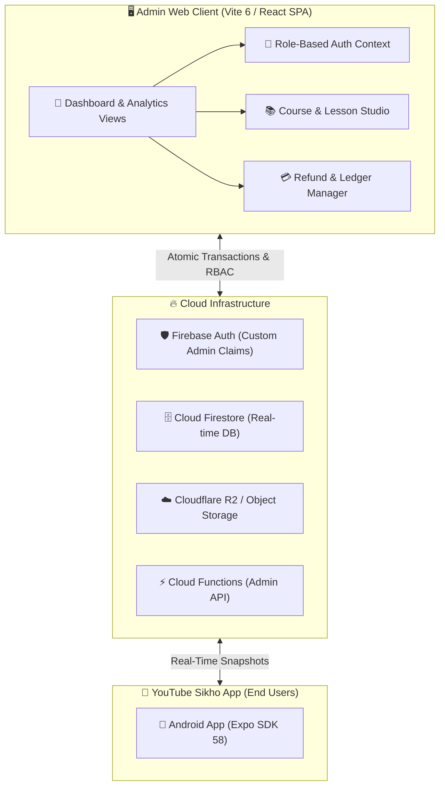

<div align="center">

# 🎛️ YouTube Sikho Academy — Command Center
### *Enterprise Admin Portal & Real-Time Operational Console*

[](https://vitejs.dev)
[](https://react.dev)
[](https://www.typescriptlang.org)
[](https://tailwindcss.com)
[](https://firebase.google.com)
[](https://pages.cloudflare.com)

<br/>

> **YouTube Sikho Command Center** is the centralized mission control web dashboard for managing instructors, video curricula, live streams, quizzes, payments, and student analytics across YouTube Sikho Academy.

<br/>

[📊 Dashboard Overview](#-operational-capabilities) • [🏗 Architecture](#-architecture--data-flow) • [🚀 Quick Start](#-getting-started) • [🛡 RBAC & Security](#-security--rbac)

---

</div>

<br/>

## 🌟 Operational Capabilities

```
┌─────────────────────────────────────────────────────────────────────────────┐
│                       ACADEMY MISSION CONTROL DASHBOARD                     │
├─────────────────────┬───────────────────────────┬───────────────────────────┤
│ 📈 Analytics & Sales│ 📚 Course Studio          │ 🔴 Live Operations        │
│ • Real-time Revenue │ • Unlisted Video Sync     │ • YouTube Live Scheduler  │
│ • Daily Enrollments │ • Cloudflare R2 Materials │ • Real-Time Chat Moderation│
│ • Razorpay Refunds  │ • Timed MCQ Quiz Engine   │ • FCM Push Notification   │
└─────────────────────┴───────────────────────────┴───────────────────────────┘
```

<br/>

### 1. 📊 Real-Time Financial & Enrollment Intelligence
- **Live Revenue Tracking**: Instant transaction feed synced with payment gateways.
- **Automated Access Revocation**: 1-click refund execution with immediate, atomic Firestore enrollment revocation.
- **Audit Trails**: Tamper-evident chronological logs tracking every admin change.

### 2. 🎬 Curriculum Studio & Study Materials
- **Unlisted YouTube Video Management**: Embed and organize private lesson playlists without exposing raw streaming links.
- **Cloudflare R2 Zero-Egress Storage**: Upload and distribute student cheat-sheets, source code, and PDFs with signed URL protection.
- **Interactive MCQ Exam Engine**: Configure negative marking, passing percentages, and randomized question ordering.

### 3. 📣 Student Engagement & Broadcast Hub
- **Targeted FCM Push Notifications**: Send segment-filtered push broadcasts directly to mobile app users.
- **Live Stream Scheduler**: Coordinate YouTube Live streams with student chat moderation tools.
- **Google Play Data Safety Deletion Portal**: Fully compliant automated account and personal data erasure workflow.

---

<br/>

## 🏗 Architecture & Data Flow



---

<br/>

## 🛠 Tech Stack

| Layer | Technology |
| :--- | :--- |
| **Frontend Framework** | React 18, Vite 6, TypeScript 5.3 |
| **Styling & Icons** | Tailwind CSS 3.4, Lucide React, PostCSS |
| **State & Navigation** | React Router DOM v6, React Context |
| **Cloud Services** | Firebase Auth, Cloud Firestore, Cloud Functions |
| **Object Storage** | Cloudflare R2 (S3-Compatible zero egress) |
| **Deployment** | Cloudflare Pages / Firebase Hosting (`sikho-77341.web.app`) |

---

<br/>

## 🚀 Getting Started

### Prerequisites
- Node.js `v20+` or `v22+`
- npm `v10+`

### Installation & Development

```bash
# 1. Navigate to the admin directory
cd admin

# 2. Install dependencies
npm install

# 3. Start local Vite development server
npm run dev
# Running on http://localhost:5173

# 4. Build optimized production bundle
npm run build
```

---

<br/>

## 🛡 Security & RBAC

- **Admin Claims Enforcement**: Route protection verifies `token.claims.admin === true` before mounting operational views.
- **Firestore Security Rules**: Administrative write rules strictly check `request.auth.token.admin == true`.
- **Zero-Token Storage**: API secrets and master credentials are never bundled into client distributions.

---

<div align="center">
  <sub>Confidential & Proprietary. Designed exclusively for <b>YouTube Sikho Academy</b>.</sub>
</div>
